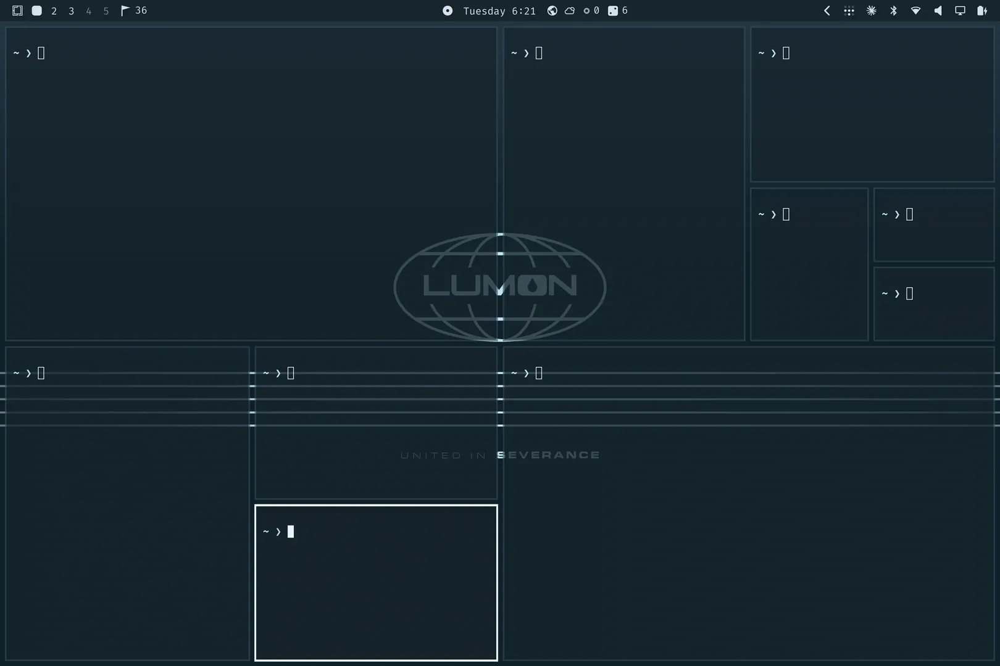

# fluid-focus

A focus animation for Hyprland window borders, built on Omarchy.

When focus moves from one window to another, the border colour drains out of
the old window towards the new one, and fills the new window from the side you
came from. The focused window also gets a slightly thicker outline.



[Full-resolution video](media/fluid-focus.mp4)

- The fill starts fast and eases to a stop; larger windows take longer.
- The drain is quick and steady.
- The sweep runs left, right, up or down, following the focus key you pressed
  (wrap-arounds included) or, for mouse focus, the direction between the windows.
- Colours come from your theme's active and inactive border colours.
- It switches itself off on Omarchy's floating workspaces.

## Requirements

- Hyprland 0.55 or later, using the Lua config (`~/.config/hypr/hyprland.lua`).
- Developed and tested on Hyprland 0.56.2 with Omarchy. It should run on plain
  Hyprland with a Lua config, but that is untested.

## Install

```bash
git clone https://github.com/Jok8675/fluid-focus.git
cd fluid-focus
./install.sh
```

The installer copies `fluid-focus.lua` to `~/.config/hypr/`, adds
`require("hypr.fluid-focus")` to the end of `hyprland.lua` (keeping a backup),
and reloads Hyprland.

## Settings

Edit the `settings` table at the top of `~/.config/hypr/fluid-focus.lua`.
Hyprland reloads on save.

| Setting | Default | What it does |
|---|---|---|
| `px_per_step` | `196` | Fill speed: one step per this many pixels of outline. Lower is slower. |
| `min_steps` / `max_steps` | `6` / `40` | Shortest and longest fill, in steps. |
| `drain_steps` | `8` | Length of the drain, in steps. |
| `step_ms` | `16` | Milliseconds per step. |
| `ring_focused` / `ring_filling` | `1` / `2` | Extra outline on the focused window, in pixels. Set both to `0` to disable. |
| `rebind_focus_keys` | `true` | Rebind `SUPER + arrow` so wrap-arounds animate the way the key points. |

For your own focus binds, call `fluid_focus.focus("l")` (or `"r"`, `"u"`, `"d"`)
instead of `hl.dsp.focus({ direction = ... })`.

## What it changes

Read this before installing; the effect needs to take over a few things.

- **Border fade:** Hyprland's own `border` animation is turned off, because it
  blends over the fill. The drain replaces it.
- **Shadows:** the extra outline is drawn with Hyprland's shadow, so the shadow
  settings are taken over and the `fadeShadow` animation is turned off. Setting
  both ring sizes to `0` leaves shadows alone.
- **Focus keys:** `SUPER + arrow` are rebound to the same action, plus a note of
  the direction pressed.
- **Inactive border colour:** every window is given an explicit copy of the
  theme's inactive border colour, which overrides window rules that set one.
- **Two monitors:** with an Omarchy floating workspace on one monitor and a
  tiled one on the other, the shadow style follows whichever window has focus.

## Known limits

- The outline thickness is one value for the whole window, so the thicker
  outline cannot follow the fill; it fades in at the end instead.
- The drain relies on how Hyprland 0.56 parses per-window border colours (it
  skips the first colour in the list). A Hyprland update may break it.

## Uninstall

```bash
./uninstall.sh
```

Open windows keep their explicit inactive border colour until Hyprland
restarts, because Hyprland has no way to clear it. Log out and back in.

## License

MIT
